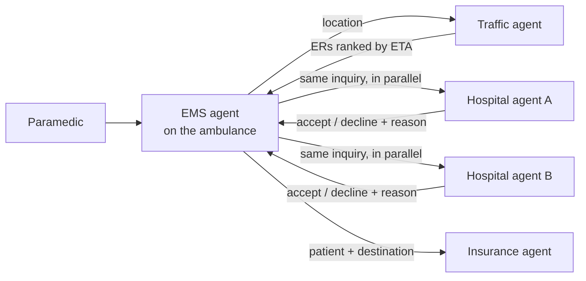

# ambulance

**A multi-agent system that finds an emergency room for an ambulance patient in about 50 seconds.**

In Korea, paramedics often phone hospital after hospital until one agrees to take the patient. Ambulances circling between ERs that turn them away has a name of its own, and it costs patients the golden hour. This project replaces those phone calls with agents. Each institution runs its own agent: the ambulance, the traffic service, every hospital and the insurer. They talk to each other over the [A2A protocol](https://a2a-protocol.org/).

Measured on live APIs (Kakao Mobility, Notion, Slack, Gemini), from patient intake through hospital confirmation to the insurance request: **about 50 seconds**, with every step in an audit log.

## How a dispatch runs

1. **Triage.** The EMS agent collects the patient's details from the paramedic and assigns a KTAS level (Korean Triage and Acuity Scale) and the specialty needed.
2. **Rank ERs.** The traffic agent finds nearby emergency rooms and ranks them by real, traffic-aware drive time in one Kakao Mobility request (through a local MCP server). Traffic accidents are also reported to a Slack channel.
3. **Ask hospitals in parallel.** The EMS agent sends one inquiry to the top five hospitals at the same time instead of calling them one by one.
4. **Decide in code.** Each hospital agent checks its own Notion staff and facility databases. Acceptance is a rule, not a model's judgment: **operating rooms ≥ 1 and beds ≥ 1 and a surgeon in that specialty who is not in surgery** ([`capacity.py`](hospital_agent/capacity.py)).
5. **Pick the closest hospital that can take the patient.** The EMS agent takes the first acceptance in ETA order. If none accept, it asks the next five.
6. **Insurance.** The insurance agent sends a verification request to the insurer.

In the recorded demo run, a stroke patient's nearest hospital (100 m away) declined because it had no bed. The second (2.9 km) accepted, and the ambulance was routed there.

## Design choices

- **The model proposes, code decides.** Ranking, the acceptance rule and the Slack message format are deterministic code. The LLM maps symptoms to a specialty and handles language. Moving this logic out of the prompts shrank a 220-line prompt to about 30 lines and removed a class of made-up numbers.
- **One hospital codebase, many hospitals.** A hospital joins with one profile file in [`hospital_agent/configs/`](hospital_agent/configs). No code is copied.
- **Failures are visible.** Every tool error comes back as an error. A hospital without an agent is reported as "call directly", never silently skipped.
- **Authenticated and audited.** Agents share a bearer token, secrets stay in per-service `.env` files, and every dispatch decision with its timing goes to `dispatch_audit.jsonl`.
- **Same pipeline in Korean or English.** Each agent detects the request's language in code and answers in it.

## Repo map

| Path | What it is |
|---|---|
| [`host_adk/ems_agent/`](host_adk/ems_agent) | EMS (host) agent: triage prompt, parallel hospital fan-out, A2A client, audit log |
| [`traffic_agent/`](traffic_agent) | Traffic agent and its Kakao MCP server (`server.js`, `tools/`), port 10002 |
| [`hospital_agent/`](hospital_agent) | Parameterized hospital agent; `configs/` holds one profile per hospital (ports 10003, 10004) |
| [`insurance_agent/`](insurance_agent) | Insurance agent, port 10005 |
| [`demo/`](demo) | Scripted end-to-end scenario: `bash demo/run_demo.sh` |
| [`docs/setup.md`](docs/setup.md) | Keys, hospital profiles, Notion schema, how to run |

## Stack

Python 3.11+, [Google ADK](https://google.github.io/adk-docs/) 2.x, A2A, MCP, Gemini 2.5 (Pro for the host's triage, Flash-Lite for the workers), Kakao Mobility and Kakao Local APIs, Notion, Slack.

## Run it

See [docs/setup.md](docs/setup.md). In short: fill in each service's `.env`, start the four remote agents, then `uv run adk web` in `host_adk/`.

## Limits and next steps

- Input is text; voice input is the next step.
- Hospital capacity comes from demo Notion databases. The next step is the national real-time ER bed API, then a pilot with one or two hospitals.
- KTAS levels from the LLM support the paramedic's judgment; they don't replace it.

## License

[MIT](LICENSE)
